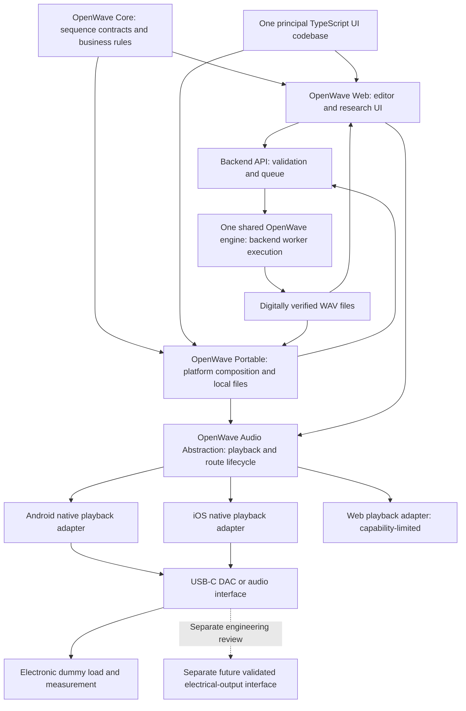
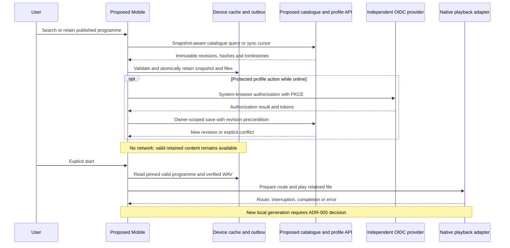

# ADR-002: portable mobile playback architecture

22 October 2026. **Architectural direction confirmed by the maintainer; framework and execution choices remain proposed pending evidence.** INV-04/05/07; hardware gates INV-03/06. The maintainer's follow-up selects one shared OpenWave engine, one principal TypeScript UI codebase, and separate web/Android/iOS audio adapters. This does not supersede [ADR-001](Architecture.md), adopt a framework, authorize native development or change the [v0.3 signal contract](wiki/Signal-Specification.md).

## Context and recommendation

**Enterprise target review, 23 October 2026:** [ADR-004](ADR-004-Enterprise-Evolution.md) adds proposed catalogue/profile/OIDC clients; React + TypeScript + Capacitor is the preferred candidate to evaluate, subject to current plain-TypeScript UI reuse. No React migration or framework is selected. The requested local-WAV generation target conflicts with current backend-only execution and is explicitly gated by [ADR-005](ADR-005-Offline-Generation.md); earlier offline-playback scope remains valid until an amendment is approved.

**Later documentation-only hardware investigation:** The [ESP32-S3 comparison](wiki/ESP32-S3-Investigation.md) and [Portable decision register](wiki/Portable-Concept.md#portable-hardware-decision-register) add USB-audio streaming and command-based MCU generation candidates. No board, firmware or transport is selected. Option A can consume existing files; Option B remains subject to an explicit ADR-001 execution amendment and a credible one-engine portability/conformance plan. This review does not authorize local generation or amend this ADR.

**Later desktop implementation:** The maintainer subsequently authorized a desktop player under [ADR-003](ADR-003-Desktop-Player.md). `apps/frontend/src/audio-output.ts` and the browser adapter now exist; live streams reuse the backend engine. The mobile scope/approval gates below remain separate. The earlier “proposed playback boundary” describes the mobile design stage, not absence of the desktop implementation.

Portable operation should use local smartphone waveform files, USB-C audio and an external interface where necessary. The existing frontend is plain TypeScript/Vite DOM code. Backend TypeScript rendering exists; Node filesystem, SQLite and process adapters are not mobile/browser modules. The connected preview is uncommitted work, not a mobile product; see the [audit](Mobile-Research-Audit.md).

Retain **one shared OpenWave engine, one principal TypeScript UI codebase and separate audio adapters for web, Android and iOS**. Web and Portable are platform compositions of those shared components, not separate implementations of sequence logic or waveform maths. Platform-specific presentation should be limited to demonstrated needs. Framework selection follows the audit and validation findings; there is no commitment to native applications or a Capacitor trial yet.

Capacitor around the existing UI remains a candidate worth evaluating. Do not migrate to React solely to obtain Capacitor. React + TypeScript + Capacitor is an option if future UI requirements justify migration. Capacitor can wrap existing web projects [S39] and bridge native APIs through plugins [S40]; neither source guarantees a ready-made measurement-grade playback plugin.

Where native integration is justified, adapters should manage local-file playback, route reporting, interruptions and background lifecycle. Candidate APIs include Kotlin/Android managed playback (for example Media3 [S32]) and Swift/AVFoundation with AVAudioSession [S35–S37]; check WAV decoding and deployment-target availability before selecting dependencies. React Native/native UI remain evaluated alternatives, not an automatic fallback: replacing or duplicating the principal TypeScript UI requires an explicit evidence-based revision of this direction. React Native requires a DOM UI rewrite and native audio integration [S41].

Mandatory SOLID, frontend/backend tests and backend-process generation remain. POC 1 downloads/imports verified WAV files for offline playback. **Fully offline custom generation and live synthesis on the phone require an explicit ADR-001 amendment.** Native execution alone does not meet the present backend placement rule. A WebView worker, PWA cache or Capacitor plugin must not silently bypass it.

## Options compared

Decision status is explicit:

| Item | Status |
| --- | --- |
| One shared engine, principal TypeScript UI and web/Android/iOS audio adapters | Maintainer-confirmed direction; documentation changes remain local/unmerged |
| Backend worker execution of synthesis/encoding | Existing adopted ADR-001 requirement; unchanged |
| Capacitor, React migration, React Native or fully native UI | Evaluated alternatives; no framework or UI rewrite selected |
| Playback adapters and portable POC | Proposed; define common contract/capability validation before implementation |
| Phone/DAC and physical-output compatibility | Not verified; named-device/load measurements required |

These are architecture assessments, not benchmarks or compatibility results. Capacitor with the current UI shares the audio characteristics of the React/Capacitor option without its React migration.

| Criterion | Existing Web / prospective PWA | React + TypeScript + Capacitor | React Native | Native Kotlin + Swift |
| --- | --- | --- | --- | --- |
| Existing code reuse | Highest UI/API reuse; PWA absent | TS logic reusable; React UI migration; direct wrapping avoids it | TS contracts reusable; DOM UI rewritten | Specs/fixtures reusable; UI/orchestration rewritten |
| Android | Browser/device dependent | Native project and WebView matrix | Native project/runtime | Direct Android APIs |
| iOS | Browser/device dependent | Native project and WebView matrix | Native project/runtime | Direct iOS APIs |
| USB-C Audio Class | OS-selected audio route | OS USB driver through native adapter | OS USB driver through native module | OS USB driver; same hardware limits |
| External routing | Browser capability/permission dependent | Native observation/policy required | Native module required | Direct observation/policy |
| WAV reliability | Codec/storage/browser testing | Native decoder/storage tests | Native decoder/storage tests | Same decoder/storage tests |
| Live synthesis | Technically possible; prohibited under current rule | Native engine possible; separate decision | Native engine possible; separate decision | Native engine possible; separate decision |
| Background | Suspension risk; not release baseline | Native service/session; no WebView timing loop | Native service/session; no JS timing loop | Direct lifecycle implementation |
| Screen lock | Unverified; PWA install is no guarantee | Native configuration and tests | Native configuration and tests | Direct configuration and tests |
| Interruptions/recovery | Browser events may be insufficient | Plugin maps native events | Module maps native events | Direct native events |
| Offline | Cache/import work needed; generation needs backend | Persistent local playback; generation needs backend | Same backend constraint | Same unless ADR-001 amended |
| Deterministic playback | No physical timing guarantee | Pre-rendered PCM; measure gaps/timing | Pre-rendered PCM; measure gaps/timing | More direct control; OS/DAC clocks still apply |
| Battery | Unknown; measure | Unknown; measure native playback plus WebView | Unknown; measure runtime plus playback | Unknown; no assumed advantage |
| Maintainability | Fewest layers; mobile limits | Web UI plus two narrow native adapters/plugin upkeep | New UI/runtime plus native adapters | Two UI stacks/platform specialists |
| Testability | Current jsdom/unit suites plus device tests | Shared contracts, Kotlin/Swift units and physical tests | TS/native units and physical tests | Two native suites, golden fixtures and physical tests |
| App stores | Browser distribution; packaging separate | Native signing/packaging/store review | Native signing/packaging/store review | Native signing/packaging/store review |
| Cost/complexity | Lowest incremental editor work; mobile gaps | Moderate shell/plugin effort; React increases migration | Higher rewrite/integration effort | Highest duplicated UI effort initially |

No cost quotes or battery measurements support these relative effort assessments. Store eligibility, developer-account requirements, signing, build hardware and fees require a later review. No account enrollment or spending is authorized.

## Component boundaries

**OpenWave Core / shared engine** is a logical target, not an extracted package already present. Maintain one authoritative implementation of waveform maths, sequence semantics and WAV generation, with shared bounded contracts and business rules where platform compatible. For the current architecture, synthesis executes in backend workers and all clients use its output; “shared” does not mean the engine runs in every client. Do not put synthesis/Node adapters into frontend shared contracts. Any later change in execution location requires a reviewed ADR-001 amendment and conformance tests, while preserving one engine rather than platform-specific formula copies.

**OpenWave Web** edits and submits sequences and downloads backend artifacts. It has no authorized local generation fallback. **OpenWave Mobile** retains local files and controls playback independently of WebView timers. Backend artifact expiry must not invalidate an already retained local copy. Persistent storage, metadata/checksums, import validation and deletion policy require tests.

**OpenWave Audio Abstraction** is a proposed playback-only port: load a local file, prepare, start, stop, report position/state/actual route and emit interruption/disconnection/errors. Suggested states: idle, preparing, ready, playing, interrupted, stopped, completed, failed, disconnected. Report unknown or unsupported route controls explicitly; Android/iOS do not offer an identical universal “force USB” operation.

Native adapters own bounded decoding/streaming, audio focus/session and background facilities. Do not move full PCM through the JS/native bridge. Shared policy pauses/stops on interruption or unexpected route and requires deliberate restart after route confirmation. An optional future Web playback adapter can support restricted research playback; it cannot substitute for native USB/background conformance or perform synthesis.

Route confirmation itself is a POC risk: some Android actual-route queries are meaningful only while playback is active [S34]. Device enumeration/preferences before start cannot prove the eventual route. Validate a bounded preparation/start policy on electronic loads, record any transient fallback, and mark a pairing unsupported if the required route policy cannot be established. Do not promise that application notifications prevent all OS rerouting or mixing.

## Proposed architecture

No existing diagram notation was found in the reviewed documents; this ADR introduces Mermaid. Mobile, playback abstraction and USB integration below remain proposals. The dotted hardware extension is outside POC 1.

“Digitally verified” is not a calibrated physical output. No human-contact path is included. USB-C remains mandatory for the proposed portable hardware path.

## Proposed mobile catalogue and offline flow

23 October 2026, **PROPOSED ARCHITECTURE**. Mobile responsibilities expand to published catalogue search/filter/detail, programme retrieval, saved programmes, offline catalogue caching and optional authenticated profile sync, plus playback/routing/interruption/USB-C duties. Local custom WAV generation is a target, not implemented or authorized by the existing execution policy. A downloaded valid programme/file must play without a continuous API or IdP connection; public cached playback must not require recurring sign-in. Private entitlements/offline expiry need a separate explicit policy and user-visible limits.

Maintain snapshot/version and change cursor, published revision IDs/hashes, last successful sync and schema/contract compatibility. Use ETags to avoid redundant transfers; cursor expiry triggers bounded full re-sync. Apply changes/tombstones atomically, record retractions and retain pinned historical content only under agreed rights/retention policy. Never silently change saved programme settings when a catalogue entry updates. Reject incompatible schemas, unsupported shapes/rates and incomplete programmes visibly.

Separate immutable published cache from user edits and a bounded local outbox. Apply the [identity-bound cache/outbox rules](Identity-and-Security-Architecture.md#identity-bound-cache-and-outbox): bind every private operation to its originating profile/issuer/subject and deployment; stop replay on account mismatch and invalidate old-account asynchronous callbacks. Confirmed logout discards private queued changes only after the explicit unsynced-data warning. Saved-programme edits carry a base revision and operation ID; reconcile with ownership checks and explicit conflict resolution or a fork, not last-write-wins data loss. Favourites can be idempotent set operations with revision/tombstone handling. Offline devices cannot learn of retractions/revocation instantly: display last-sync/evidence/version status. Apply the [dependent withdrawal policy](Catalogue-and-Data-Architecture.md#withdrawal-and-dependent-programme-policy) before reconnect replay or further catalogue-based generation; never silently republish quarantined content. Do not automatically download private source documents.

Use the [programme package contract](Programme-Package-Contract.md) to bind immutable programme settings, supported engine/contract identity, manifest digest and exact WAV bytes. Download to temporary local storage, verify the complete binding, then atomically promote. Test partial download, corruption, eviction, low storage and restart. A cached research entry without complete settings/audio is not an offline-playable programme. See [IAM/security](Identity-and-Security-Architecture.md) for private-cache and deletion requirements. Do not expose the loopback API on a phone/LAN as a deployment shortcut.

Evaluate all four framework choices in the comparison above against these requirements. Direct Capacitor wrapping of the existing UI is the lower-migration comparator; React requires a documented UI benefit. Native playback/background/lock/USB/protected storage needs named-device tests regardless of framework. React Native/native UI requires DOM replacement; a PWA cache cannot establish route/background guarantees or a permitted synthesis runtime. No choice is declared reliable from documentation alone.

## Risks and adoption gates

Risks: plugin upkeep, WebView lifecycle where a hybrid shell is used, route observability, OS mixing/resampling, DAC clock/gain/power variation, speaker fallback, storage eviction and untested phone/interface pairs. A PWA remains an editing candidate but has not passed portable playback acceptance. No shell/native UI is selected; failure of an adapter trial would trigger a documented options review, not authorize a second UI implementation.

The next decision is evidence-led: define the common playback contract and capability matrix, identify devices and assess web/platform gaps before selecting a shell or authorizing native implementation. Subsequent implementation requires named Android/USB-C iPhone/DAC combinations, API/version review, compulsory unit/contract tests, background/lock/interruption/disconnect tests and independent loaded-output measurements. Follow the [POC plan](wiki/Mobile-POC.md). This direction establishes neither human-contact safety, medical effects nor Electro-Med equivalence.
