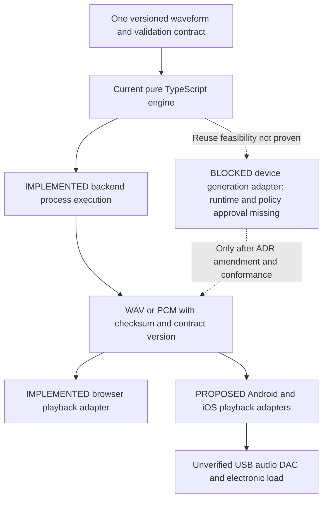

# ADR-005: offline mobile generation and one-engine execution gate

23 October 2026. **DECISION REQUIRED — proposal; no amendment adopted.** The master task [S57] makes local WAV generation a target capability. Current maintainer instructions, [ADR-001](Architecture.md) and [coding standards](Coding-Standards.md) require heavy synthesis/encoding in backend processes and forbid browser/browser-worker/API-handler synthesis. Both facts must remain visible. A mobile framework, offline cache or “background” label does not resolve the conflict.

## Current versus target

Current web/desktop exports/live streams call the same backend planner/encoder. The pure mathematical modules avoid Node/DOM dependencies, but TypeScript code sharing alone does not establish an available native mobile execution runtime. Node SQLite/filesystem/process adapters are not mobile modules. Offline playback of a retained valid file is independent of generation and remains the first mobile verification scope.

The target is an optional native/device execution adapter running **the same authoritative rules** outside UI timing loops, with conformance for frames, PCM rounding, phase, fades, supported harmonics, amplitude and validation. No second Kotlin/Swift/C#/C++ oscillator is approved. React/Capacitor wrapping does not execute the current Node worker on a phone. A TypeScript-native runtime or a portable compiled engine would need separate supported-runtime, precision, security, performance and maintenance evidence; neither is selected here.

## Recommended delivery baseline

Use the existing authoritative TypeScript engine in backend processes for R1/R2 and generated files retained for R3 offline playback. **Do not make local mobile generation a dependency of those releases.** This recommendation follows the adopted execution rule rather than inventing a native-runtime exception. See the [independent release gates](Release-Readiness.md).

The new-local-generation target is isolated as R4. Before it can proceed, the owner must approve a scoped execution amendment and select a demonstrated one-engine native/device runtime strategy; no such runtime is proven or selected here. The documentation decision is explicit: retain backend execution until that gate passes. Fixing these documents does not authorize a Capacitor/browser worker, duplicated C#/Kotlin/Swift oscillator or silent removal of the long-term local-generation objective.

R4's approval record must identify engine ownership/runtime, supported contract/build versions, memory/chunk/cancellation/thermal/storage bounds, mandatory numerical/native tests and affected AGENTS/ADR wording. If no viable shared runtime is evidenced, keep R4 deferred while R1–R3 remain independently assessable.

## Options for an owner decision

| Option | Benefit | Limitation and decision gate |
| --- | --- | --- |
| Keep backend generation plus offline retained WAV playback | Fits adopted policy and reuses existing engine immediately | Cannot create new custom WAVs without backend access; does not satisfy full target |
| Approve bounded native mobile generation using one engine | Could satisfy offline custom generation without browser DSP | Requires an explicit scoped ADR-001/AGENTS execution exception, runtime design, cancellation/thermal/power tests and one numerical oracle/fixture contract |
| Replace the authoritative engine with a portable implementation | Potential multi-runtime reuse | Highest migration/conformance burden; must replace, not maintain divergent formula copies; existing bytes/rules require compatibility decisions |

Do not invent a decision. Owner review must state whether device-native background processing is allowed, where encoding executes, supported rates/durations/shapes, energy/storage limits and which runtime preserves one-engine ownership. If not approved, document the product limitation and retain backend-only generation. No UI timer, Web Worker, Capacitor plugin or new backend language may silently bypass this gate.

## Required evidence before implementation approval

Define canonical programme/contract versions and golden fixtures; preserve the existing 64-case evidence and explicit cross-runtime tolerances rather than promise bit-identical trigonometric libraries. Plan native adapter tests, bounded memory/chunking, cancellation, interruption, storage failure, resource admission, thermal/battery and digital-to-physical separation. Mobile local generation and future .NET backend migration need independent decisions but must share this same engine strategy. No code, dependency, firmware or execution-policy file changes occur in this review.
