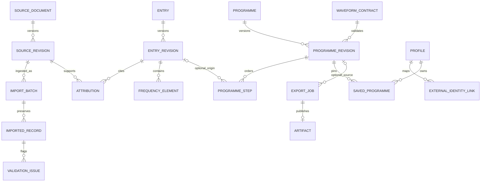

# Catalogue, programme and API architecture

23 October 2026. **PROPOSED ARCHITECTURE — no database, import or migration created.** See [ADR-004](ADR-004-Enterprise-Evolution.md). The existing `apps/backend/src/adapters/sqlite-export-store.ts` creates local `jobs`, `sessions` and `submissions` tables with SQLite transactions. They are job/session/rate-limit state, not a research catalogue, IAM directory or versioned migration system. `CREATE TABLE IF NOT EXISTS` is not an upgrade/rollback strategy.

## Source material and evidence boundary

The owner-supplied presentation is referenced in [Frequency List Review](wiki/Frequency-List-Review.md) and S27/S28. The generic presentation file is available in the owner's local Downloads directory but **not in the repository**. A lawful, versioned source copy plus redistribution/import permissions is a required input before actual ingestion. Do not copy the private file into Git or invent records from the review. The review identifies individual values, ranges, sweep notes, uncertain characters and inconsistent settings, not a licensed, normalized database.

A catalogue entry records a historical/user-reported association and its provenance; it is not a therapeutic recommendation or automatically a renderable programme. Missing waveform, duration, amplitude, units, sweep law or transition behaviour stays missing. A user can explicitly author those settings in a separate programme revision, with attribution to the entry and clear distinction between sourced and user-authored data. Never fill them silently during import/publication.

## Database candidate and ownership

PostgreSQL is the preferred central business-database candidate [S57/S62]. Schemas can organize module ownership and privileges; they do not make data inaccessible without correct grants and application boundaries. Keep production database roles separate for migration, runtime and read-only operations. A single PostgreSQL database with module schemas is the initial proposed composition, not a database per microservice.

| Candidate | Assessment | Required decision evidence |
| --- | --- | --- |
| PostgreSQL | Preferred for relational source/revision/programme relationships and portable deployment; not implemented | Driver/ORM and decimal mapping, migrations, indexing/query workload, backup/restore and operator skills |
| Existing SQLite | Fits local single-host export queue; no current catalogue schema | Retain prototype compatibility; do not claim horizontal multi-host writer/worker support |
| SQL Server | Alternative only if team/operator requirements justify it; absent in repo | Supported runtime/container/driver, licensing/operations, portability and actual query/recovery evidence; no selection inferred |

## Logical schemas and invariants

Names below describe ownership, not SQL DDL. IDs are opaque stable identifiers; timestamps are UTC. Preserve original text and exact decimal representation separately from parsed numeric values. Parsing failures remain staged and reviewable.

| Owner/schema | Entities and relationships | Constraints / access |
| --- | --- | --- |
| `research` | SourceDocument → SourceRevision → ImportBatch → ImportedRecord; ValidationIssue references record/batch | Document title/source URI/author/attribution, rights status/licence, retrieval/version/hash, original text and page/slide/offset locator; parser version/settings and duplicate links. Rights-restricted raw documents stay private; hash alone is not permission |
| `catalogue` | Entry → EntryRevision; revision links one or more ImportedRecord/SourceRevision records via Attribution; revision → FrequencyElement | Immutable revisions, evidence classification and reviewer history; values retain original units/precision. Fixed value versus range versus sweep is explicit; ambiguous/unknown units cannot be published as executable Hz |
| `waveforms` | WaveformDefinition → ContractVersion | Owns identifiers and mathematical specification references, not another numerical implementation; approved engine/spec hash and supported limits recorded |
| `programmes` | Programme → ProgrammeRevision → ordered ProgrammeStep; optional step/source EntryRevision links | A catalogue reference does not supply absent playback settings. Immutable revision requires explicit shape, duration, amplitude, rate/channel policy, ordering and transition semantics to pass renderability |
| `profiles` | Profile → ExternalIdentityLink, Preferences, Favourite, SavedProgramme, Entitlement | Unique issuer+subject mapping; favourite references a stable entry, saved programme pins a revision. No password/hash/MFA seed/token in business tables |
| `rendering` | ExportJob → Artifact; job pins ProgrammeRevision or immutable validated ad-hoc sequence snapshot | Owner access, contract/source/runtime/checker versions and checksum, terminal states/retention; public programme publication never makes private jobs public |
| `audit` | Append-only AuditEvent and module-owned OutboxEvent | Actor/service identity, action/resource/revision, time, correlation and disposition; no raw secrets or full private sequences in events |

For FrequencyElement, store a tagged structure: fixed numeric value, or range endpoints, or sweep parameters explicitly present in the source. A missing sweep duration/curve is unresolved data, not a runnable sweep. Use reviewed finite decimal bounds and unit vocabulary; non-Hz source units are preserved until a reviewed conversion exists. Do not coerce out-of-engine-range research values into the current 20–10,000 Hz render contract. Current renderer does not implement sweeps; such records can be stored as research while render validation rejects unsupported programmes.

Programme renderability must bind `waveform_contract_version` separately from existing `schema_version: 1`. The proposed [Programme Package v1](Programme-Package-Contract.md) specifies the canonical programme, engine/build identity and exact WAV/manifest integrity binding. Retain integer microsecond duration semantics, cumulative frame rounding, PCM16 quantization, fades/phase resets, >0 to 0.8 digital peak ceiling, sample-rate/channel and resource limits unless a later reviewed numerical revision changes them. Future transitions are versioned explicit enums/parameters; do not infer interpolation from list ordering. A partial programme draft may retain missing fields but cannot be rendered/published as a complete executable definition.

This is a logical proposed domain/ownership diagram, not an implemented schema or migration. Basic cardinality notation follows Mermaid's ER reference [S69]; no rendering test is claimed. Attribution can include multiple source locators; the simplified diagram does not imply every programme must originate in a catalogue entry.

## Constraints, indexes and publication workflow

Use unique constraints on stable ID+revision, programme revision+step ordinal and external issuer+subject. Enforce finite parsed values, range endpoint order where meaningful, referential integrity and explicit nullable unresolved fields. Draft → validated → reviewed → published is an audited state machine; failed/ambiguous/rights-restricted records do not auto-advance. Retract with a tombstone and reason, preserve historical revision identity, and prevent a publisher from silently replacing published values. Separate editor/reviewer/publisher permissions and concurrent-edit checks; no automatic deletion of provenance.

Proposed indexes: source hash/version and batch ID; record/source locator; catalogue published state+revision and normalized searchable label; frequency-element type/unit/value or endpoint search according to real query plans; programme ID+revision+step ordinal; profile external link, owner+saved revision; export owner+state/expiry and queued claim order; audit resource+time and outbox delivery state. Benchmark actual pagination/filter workloads before choosing full-text/trigram, JSON or additional indexes. Audit growth/retention and source rights need operator decisions.

Imports must be restartable and idempotent by source revision/hash plus parser/settings version, preserving duplicates as linked findings rather than blindly dropping them. Validate before publication; human review handles ambiguous characters and malformed ranges. Source text/URIs are untrusted data: no arbitrary remote fetching, HTML execution, SQL interpolation or filesystem paths from imports. Public fixtures remain newly authored synthetic records until rights are resolved.

## Versioned REST contracts

All new endpoints below are **proposed**, not routes currently available. Use OpenAPI contracts [S67], compatibility tests and bounded DTOs before implementation. Existing `/api/v1/exports` and `/api/v1/playback` remain governed by [Service Contract](Service-Contract.md); do not switch their error envelope or anonymous ownership silently when IAM arrives.

| Proposed resource | Contract direction | Permission / consistency |
| --- | --- | --- |
| `/api/v1/catalogue/entries` and `/{id}/revisions/{revision}` | Published entry search/detail with source/evidence labels; allowlisted query/type/unit filters, bounded stable cursor pagination | Public-read availability is a launch policy decision; never leak drafts/private source text. Stable order and snapshot/revision-aware cursors |
| `/api/v1/programmes/{id}/revisions/{revision}` | Complete immutable settings, source links, waveform-contract version and canonical hash | Published-read or owner/entitlement policy; distinguish incomplete research entry from executable programme |
| `/api/v1/catalogue/sync` | Consistent version/snapshot ID, cursor changes and tombstones; restart signal when cursor expires | Published catalogue only unless a separately scoped private sync is designed |
| `/api/v1/me/preferences`, `/saved-programmes`, `/favourites` | Owner-scoped state, revisions and conflict metadata | OIDC access token and ownership policy; explicit offline save conflict handling |
| `/api/v1/admin/import-batches`, `/entries/{id}/review`, `/publish` | Staged ingestion, validation report and review/publish commands | Editor/reviewer/publisher policy, audit trail and optimistic concurrency |
| `/health/live`, `/health/ready`, `/version` | Bounded operational responses, readiness separate from liveness | Health endpoints absent today; do not disclose secrets/schema/internal hostnames |

Specify request/response schemas, examples, limits, default/max page size, ordering, filter semantics and error codes in the implementation contract; numeric settings require workload evidence and owner review, not invented throughput promises. Proposed changes use ETag/If-Match or equivalent revision tokens; report stale writes as conflicts, not overwrite. Batch/import/generation commands need an idempotency scope/key and stored outcome, with bounded retry semantics. Compatibility policy: additive fields where safe, reject invalid executable semantics explicitly, version breaking contracts, announce deprecation and retain pinned published revisions according to an agreed policy.

Authenticate at the boundary and authorize every object/action, not only controllers. Use structured error codes and correlation IDs; do not expose stack traces. Existing export errors remain `{error:{code,message}}`; a future consistent envelope/problem-details policy must be documented and migrated explicitly. Pagination, filtering, token validation, centralized exception handling, health/OpenAPI, logs, metrics and traces are target work, not completed services.

## Withdrawal and dependent programme policy

23 October 2026, **proposed R2/R3 policy**. Track reverse dependencies from SourceRevision/EntryRevision to ProgrammeRevision, manifest, export jobs and retained package identifiers. A withdrawal record includes resource ID/revision, monotonic change version, reason code, effective time, reviewed rights/evidence disposition and replacement reference if one exists. Public tombstones must not disclose private source text or actor identity.

| Change | Server behaviour | Client behaviour after learning of it |
| --- | --- | --- |
| Informational correction; old numerical programme remains valid and distributable | Publish a new revision/advisory; preserve the old immutable record with explicit supersession/evidence status | Show the advisory and newer revision; keep pinned settings unchanged, with deliberate user choice to replace |
| Confirmed invalid programme, corrupted binding or unsupported contract | Quarantine affected programme/manifests; reject new render/download/publication and cancel affected pending work | Quarantine the affected verified package, block new starts and request software stop if playing. Do not claim hardware-level immediate silence |
| Source/entry retracted or rights disposition changes | Record reason and evaluate actual dependent content. Stop affected server distribution where the reviewed disposition requires it; quarantine uncertain dependents pending qualified rights/evidence review | Apply the programme/manifest dispositions sent by the server; retain only permitted minimal tombstone/attribution data, not disallowed payloads |
| A source is withdrawn but a programme is independently authored or remains distributable | Reviewer records the dependency/rights decision; do not assume the source's licence or withdrawal automatically governs all independently authored numerical content | Follow the explicit resulting programme disposition, not a guessed licence inference |

Maintain distinct entry and programme publication states. An entry may be published as historical research while an incomplete programme remains draft/non-renderable. Programme approval is tied to its exact immutable settings, provenance/rights assessment and manifest binding; any changed revision starts a fresh validation/review cycle. Source withdrawal or changed rights invalidates affected approval eligibility until the recorded dependent review is complete. A publisher cannot carry approval to new content or use a saved/forked revision to bypass a quarantine.

Apply withdrawal/distribution eligibility at admission, worker claim and final candidate publication, not only on a catalogue page. Recheck in the [render worker contract](Render-Worker-Contract.md) to prevent a queued pre-withdrawal job from distributing a withdrawn result. Record affected identifiers and audit disposition; keep provenance retention separate from public/private distribution rights.

The sync feed carries ordered programme/manifest tombstones and advisory changes at a consistent snapshot watermark. Apply status changes and package indexes atomically before advancing the cursor; reset expired cursors through a bounded consistent snapshot. Reconnecting queued edits against quarantined/withdrawn revisions return a conflict requiring review, not automatic republication. New user-authored settings do not erase provenance/review obligations.

An offline client cannot know a withdrawal it has not received. Retained public playback therefore uses last-known eligibility and displays last successful sync; it does not promise immediate remote recall or require continuous API access. On reconnect, eligibility synchronization precedes automatic outbox replay or new catalogue-based generation/download requests. Already exported external files cannot be remotely erased or represented as recalled. Private offline entitlement/expiry is separate scope requiring explicit approval; it cannot be silently imposed on public cached playback.

Acceptance must cover corrected-but-valid pinned content, source rights review with independent derivatives, invalid programme withdrawal while queued/rendering/playing, repeated/out-of-order tombstones, restart during apply, expired cursor recovery and offline-to-online reconciliation. These are future tests, not new execution results.

## Migrations and recovery

Choose a versioned migration tool after backend/ORM selection. Migration scripts belong to the owning module, have unique ordered IDs/checksums and run once through a deployment migration job, not concurrently from every API replica. Use expand/backfill/contract with compatible application versions, explicit transaction/lock strategy, sanitized staging rehearsal and a tested backup/restore fallback. Data fixes are reviewed, auditable migrations, not silent import normalization. No migrations are generated here.

Moving local SQLite jobs to PostgreSQL needs an explicit operational decision; transient artifacts/jobs may be drained/expired rather than copied, only after owner agreement. Keep retained programme/source data distinct from disposable export state. Test successful upgrade, failed migration, restart, lock contention, rollback/forward recovery and full restore with the chosen driver/runtime. See [deployment recovery](Deployment-and-Operations.md#backup-upgrade-and-disaster-recovery).
