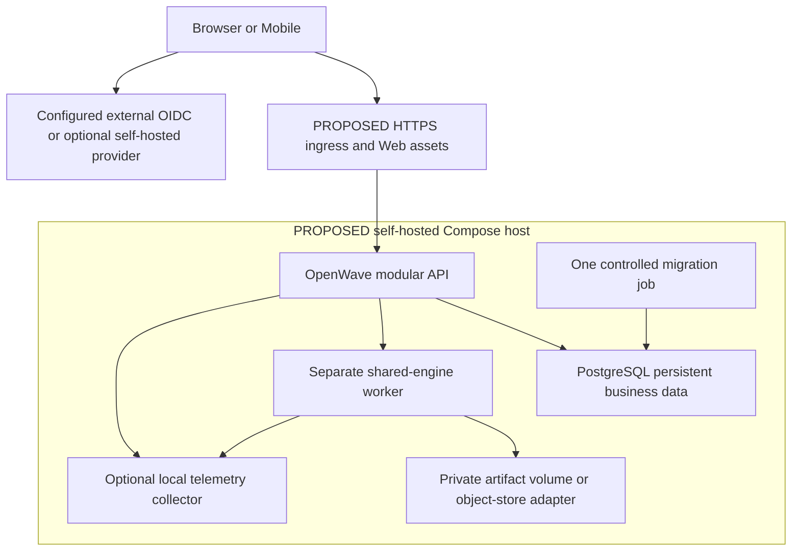
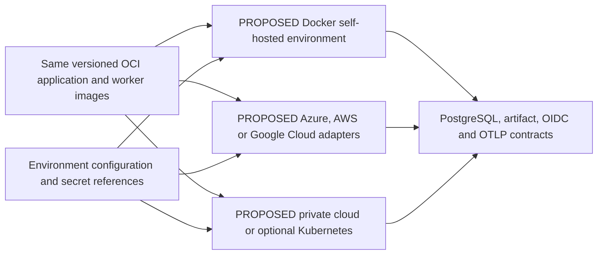

# Cloud-neutral deployment and installation requirements

23 October 2026. **PROPOSED ARCHITECTURE — no images, Compose file, Kubernetes manifests, infrastructure or migrations created.** The existing development launcher binds loopback HTTP and uses local SQLite/files; it is not a production entry point. See [Development](Development.md) for today's commands and [ADR-004](ADR-004-Enterprise-Evolution.md) for target decisions.

## Three target profiles

| Profile | Intended composition | Current support / evidence needed |
| --- | --- | --- |
| DEVELOPMENT | Reproducible runtime/tooling, local UI/API/worker, sample configuration and container-based dependencies as modules arrive | Existing npm development workflow documented; fresh-install reproduction and future container dependencies not verified by this review |
| SELF-HOSTED | Docker Compose, HTTPS ingress, API/worker, persistent PostgreSQL, private artifacts, configurable OIDC provider and backup/upgrade procedure | Entire deployment profile proposed; no Compose/package, env example, image or fresh-host acceptance exists |
| ENTERPRISE | Same portable contracts in OCI containers or optional Kubernetes; external IdP, managed database/storage, secrets, telemetry and measured scaling | Proposed; no cluster/manifests/cloud provisioning or HA claim |

Docker Compose describes multi-container services/networks/volumes [S64]; OCI describes container image/runtime interoperability [S65]. Neither guarantees that OpenWave has working images or production defaults. Simple self-hosted installation is a launch requirement, not a reason to ship insecure bootstrap or hide required database/identity operations.

## Proposed self-hosted composition

OIDC/self-hosted provider state must have separate secure persistence and backup even if co-hosted; it is not stored in OpenWave profiles. Databases/storage/management ports must not be published unnecessarily. TLS, least-privilege non-root images, resource limits, dependency readiness and graceful shutdown are implementation requirements. A healthy container process does not prove migrations, worker, database or identity configuration is ready.

## Cloud portability contract

Business modules must not depend on cloud identity SDKs, queue semantics, bucket URLs or secret services. Infrastructure adapters translate configuration for DNS/TLS, networking/ingress, image registry, volumes/managed PostgreSQL, object storage, secrets, telemetry and backup. S3-compatible or local artifact adapters need explicit contract tests for atomic publication, streaming, authorization, checksums and deletion; a compatibility label is insufficient. Provider-specific IaC modules are allowed outside domain code after selection, versioned/reviewed with reproducible inputs/state protection. Do not create infrastructure now.

Use environment-based non-secret configuration with documented types/defaults/validation: bind/public origins, trusted proxy policy, OIDC issuer/audience/client identifiers, database endpoint/schema, storage adapter, worker concurrency/queue/time/storage/retention limits, telemetry endpoint, log level and feature capabilities. Secret references are injected through the selected secret mechanism; do not place real secrets in a committed example or command history. Support secret rotation/restart semantics and fail closed on missing production configuration. Current fixed loopback settings are not general deployment configuration.

Use service DNS/networking contracts and readiness endpoints rather than hardcoded container IPs. OpenTelemetry/OTLP is the proposed vendor-neutral signal export boundary [S66]; define correlation API → job → worker, queue/latency/error/CPU/storage metrics, structured logs and PII/cardinality filtering. The collector/backend is an operator choice, not a mandatory hosted account. Instrumentation/export failures must not silently publish partial jobs or leak source/personal data.

## Target quick start — not executable today

The intended experience is clone → copy sample environment configuration → set secure secrets/provider settings → `docker compose up -d` → verify readiness and bootstrap safely. This sequence is a **target only**: no Compose or sample environment file exists and these commands have not been independently verified for OpenWave. Do not present them as today's installation guide.

To make it reproducible, a future implementation must provide reviewed Dockerfiles/image tags/digests and architecture support, a pinned Compose definition, non-secret sample config, exact prerequisite/runtime/engine/database/provider versions, volume/network definitions, source/licence notices, secure first-run identity/admin provisioning, migration order, fixture/licence policy and a smoke/backup/upgrade checklist. Declare actual supported OS/CPU/container runtime combinations. No default credentials or mandatory Azure/AWS/GCP account; externally managed IdP/DB may be configured without changing business logic.

Fresh-host acceptance must cover download/build provenance, unavailable registry/dependency, config validation, no-secrets bootstrap, HTTPS/redirects, database migration/readiness, catalogue read, private-owner access, verified export/download, restart persistence, storage exhaustion, backup/restore and upgrade/recovery. The operator needs actionable errors, logs and a support/issue route. A successful developer start with existing caches is not fresh-install proof.

## Backup, upgrade and disaster recovery

Separate durable source/catalogue/programme/profile/audit data and IdP state from disposable export artifacts. Define encryption/access, retention/legal needs, backup frequency and an agreed RPO/RTO against data-change rate and operating budget. PostgreSQL offers multiple backup approaches [S62]; choose and test the actual consistency/restore procedure, including document storage and identity mapping. File-copying a live database volume without a reviewed consistency method is not a backup strategy.

Before upgrade: record application/engine/schema/provider versions, validate compatibility, take/test recoverable backups, run a single migration job, keep old/new versions compatible where required and verify health/data/permissions/exports. Prefer rehearsed forward fixes or restore to a known consistent application+schema+storage state over an assumed reversible migration. Test failed startup, partial migration, stale worker, token/key/provider change, corrupt backup, lost host and clean-host recovery. Record measured recovery duration/loss and whether agreed RPO/RTO were met; no values are promised here.

## Scaling and operations gates

For any selected API-language migration, the initial [worker boundary](Render-Worker-Contract.md) is a supervised local Node executor with private pipes/candidate storage and one authoritative durable Rendering module. Configure the pinned engine/runtime, artifact root, process deadlines/concurrency and protocol limits explicitly. It is not an additional public worker API or an assumption of shared SQLite access from multiple languages. A multi-host transport requires its own security/operations ADR and the same fencing/publication tests.

Current SQLite claims/file artifacts are single-host local wiring, not tested multi-replica infrastructure. Horizontal APIs/workers require shared durable ownership/queue state, atomic admission/claims, idempotent publication and compatible artifact access; avoid local-session affinity as an undocumented dependency. Set concurrency after load/CPU/storage tests and bounded resource policy. A broker, Kubernetes, service mesh or distributed cache is not required until evidence justifies it.

CI/CD target: repeat mandatory frontend/backend/contract/numerical/security/licence checks, build once, record provenance/SBOM/checksums, publish immutable artifacts and use reviewed environment promotion with rollback/recovery. Remote CI currently reports billing-blocked jobs for PR #9; no CI pass, payment, new runner or deployment is claimed. Operators need runbooks for dependency outage, queue saturation, disk/backup failure, secret/key rotation, revocation, import rollback/retraction and security incidents before a supported public release.
