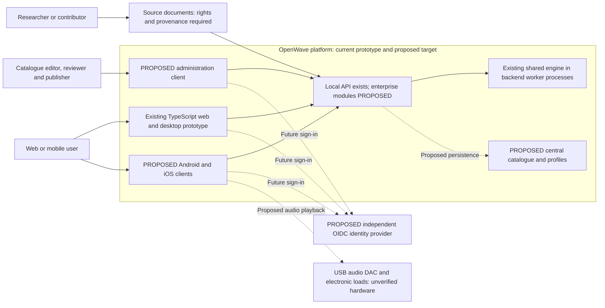
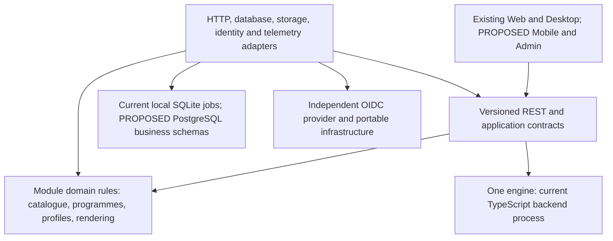
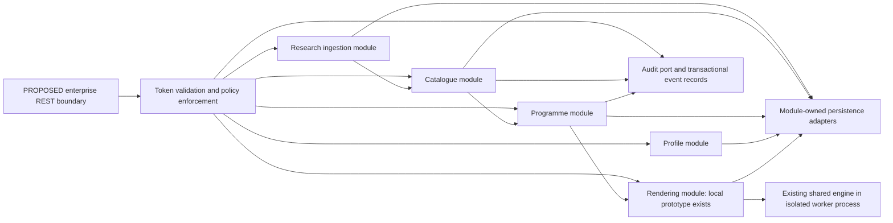
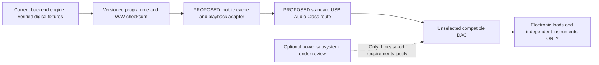

# Enterprise architecture baseline for owner review

23 October 2026. **PROPOSED ARCHITECTURE — documentation only; owner approval required before implementation.** OpenWave is an open-source waveform generation and research platform, evolving from an existing TypeScript prototype rather than a greenfield replacement. This target is not a claim of production, mobile, identity, catalogue or hardware readiness. See the [implementation assessment and readiness report](Enterprise-Architecture-Audit.md), [decision record](ADR-004-Enterprise-Evolution.md) and [offline-generation decision](ADR-005-Offline-Generation.md).

## Evidence and status vocabulary

Use **VERIFIED IMPLEMENTATION**, **DOCUMENTED DECISION**, **PROPOSED ARCHITECTURE**, **FEASIBLE BUT UNVERIFIED**, **INVESTIGATION REQUIRED**, **DECISION REQUIRED** and **BLOCKED** for architecture findings. An implementation claim must identify source and recorded tests; code presence alone is not verification. The existing wiki investigation classifications remain valid and are mapped in the audit, not renamed or closed wholesale. A proposed requirement is not deployed functionality.

## Product and system context

The target comprises one authoritative waveform engine, a versioned API, central provenance-preserving research catalogue, independent IAM capability, Android/iOS clients, the existing web client, a future catalogue administration client, bench-only USB-C integration and cloud-neutral operations. Catalogue associations retain their historical/user-reported evidence status; publishing an entry never establishes a complete playback programme, medical effectiveness or safe body contact.

## Architecture principles and dependency rules

Adopt a **modular monolith as the proposed initial business backend**, with a separate waveform worker execution boundary already required by ADR-001. Modules are logical ownership boundaries, not automatically network services or separately deployed databases. IAM is an independent standards-based capability, not OpenWave credential tables. Use Clean Architecture dependency direction: transport/storage/provider adapters depend on application ports and domain rules, never the reverse. Apply DDD to actual catalogue, programme, rendering and identity/profile terminology; do not create an aggregate or abstraction for every row/function.

SOLID, API-first/contract-first integration, input validation, versioned changes, secure defaults and compulsory tests remain controlling. UI adapters own platform lifecycle/routing, the engine owns mathematics, API modules own authorization/use cases and data modules own transactions. Keep configuration and provider SDKs outside domain logic. Schema separation does not itself enforce module boundaries; review imports, API access and migration ownership. No service may write another module's tables directly.

Business logic remains independent of ASP.NET/Node HTTP, database drivers, UI frameworks and cloud SDKs. Contracts carry versioned neutral sequence/programme data, not executable source, filesystem paths or device-specific formulas. Preserve one authoritative engine and its numerical conformance dataset. Current `packages/contracts/src/index.ts` contains only job lifecycle types; a rich shared package is a target, not present code.

## Proposed backend modules

| Module | Owns | Boundary and implementation status |
| --- | --- | --- |
| Research ingestion | Source metadata/rights, import batches, faithful original text and validation findings | PROPOSED; no source dataset/importer implemented |
| Catalogue | Research entries, parsed values/ranges, attribution, revision/review/publication state | PROPOSED; never supplies invented playback settings |
| Programmes | Complete immutable programme revisions, ordered steps, validation/renderability | PROPOSED persistence; current sequence planner implements the numerical contract only |
| Rendering | Job admission/ownership, engine contract, artifacts, cancellation and cleanup | Local TypeScript implementation exists, much still uncommitted; enterprise identity/storage integration PROPOSED |
| Profiles | External identity mapping, preferences, saved programmes, favourites and entitlements | PROPOSED; no credential ownership |
| Administration/audit | Permission-governed review/publication commands and audit records | PROPOSED logical capabilities, not another backend/service by default |

Source ingestion stages questionable/rights-restricted material for authorized review; it never auto-publishes a therapeutic catalogue. Use bounded transactions and a transactional outbox for reliable module/infrastructure notifications where needed; do not require a broker merely for module calls. External integrations need idempotency, deadlines, bounded retries and duplicate-safe consumers. A worker process is not evidence that the application is already a microservice architecture.

## Backend technology and migration assessment

Current code is TypeScript with Node HTTP/SQLite/file adapters, not ASP.NET Core, Express or MEVN. ASP.NET Core on a supported .NET LTS is the owner's preferred target candidate [S57]; .NET 10 is LTS with published support to November 2028 at review [S58]. No rewrite is mandated or implemented. Retaining the TypeScript backend initially minimizes engine and contract migration risk. A .NET API could later invoke the existing Node worker through a versioned bounded job/artifact interface, preserving one engine while adding a second runtime/operational cost. Do not translate oscillator mathematics into C# alongside TypeScript and call that code sharing.

Before selecting .NET: compare team skills, maintenance, deployment footprint, authentication/catalogue requirements, contract conformance, worker supervision and total operating cost. Demonstrate a migration slice, versioning/rollback and resource limits without interrupting existing exports; require frontend/backend and cross-runtime contract tests. The same conditions apply to replacing SQLite with PostgreSQL, which is a preferred business-database candidate, not a driver substitution already completed.

Extract a module into an independently deployed service only for measured scaling isolation, regulatory/trust separation, distinct availability needs or independently staffed release ownership. First measure load, failure boundaries and operational cost. Extraction requires an explicit ADR, owned API/event contracts, consistency/recovery strategy and deploy/observe/on-call capability. Kubernetes is an optional deployment environment, not an architecture prerequisite.

## API, security, data and operations contracts

The existing [service contract](Service-Contract.md) governs current exports/live streams. The proposed [catalogue/API model](Catalogue-and-Data-Architecture.md), [IAM/security requirements](Identity-and-Security-Architecture.md) and [deployment profiles](Deployment-and-Operations.md) add future requirements without silently changing current endpoints or credentials. Health/readiness, OIDC validation, OpenAPI, structured logs, metrics/tracing, pagination, catalogue storage and public deployment remain absent until implemented and tested.

## Portable software and hardware interface

This interface is distinct from the [functional hardware diagram](wiki/Portable-Concept.md#concept-v02-functional-specification). No ESP32-S3/AD9833 or general amplifier is required by the baseline. Rechargeability is a product option if external power is justified, not proof a battery is needed. Status indicators and physical stop/power controls are proposed human-factors requirements to assess; software mute is not a validated hardware interlock. Future independently validated body-contact output is unspecified and absent from the bench path. No PCB, circuit or manufacturing instructions are introduced.

## Review-gap closure and delivery boundaries

Use the [release readiness matrix](Release-Readiness.md) rather than a single gate spanning software and future body-contact engineering. Backend generation plus retained-file mobile playback is the recommended initial baseline; local custom generation remains isolated behind ADR-005/R4. Hardware H2 is never a prerequisite for R1–R4.

The [portable programme package](Programme-Package-Contract.md), [render worker protocol](Render-Worker-Contract.md), [identity-bound cache/outbox](Identity-and-Security-Architecture.md#identity-bound-cache-and-outbox) and [withdrawal dependency rules](Catalogue-and-Data-Architecture.md#withdrawal-and-dependent-programme-policy) supply concrete contracts missing from the first review. They are proposed specifications with acceptance cases, not implemented adapters or passing tests. Retain the TypeScript API until any selected migration proves the worker contract.
