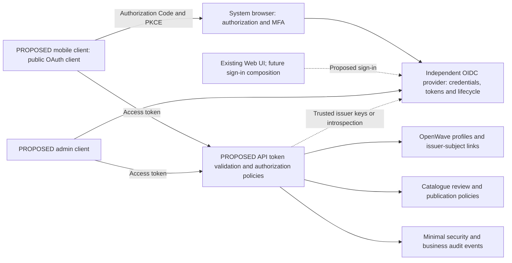

# Independent identity, application access and security requirements

23 October 2026. **PROPOSED ARCHITECTURE — no IAM provider, account system or production security deployment implemented.** Current loopback exports use hashed anonymous session ownership in `sqlite-export-store.ts`, not OIDC or user accounts. Preserve that prototype contract until an explicit migration. See [ADR-004](ADR-004-Enterprise-Evolution.md) and [data ownership](Catalogue-and-Data-Architecture.md).

## Capability boundaries

The identity provider owns credentials, authentication, identity lifecycle, token issuance, federation and MFA. OpenWave Profiles owns preferences, saved programmes, favourites and entitlements. Catalogue Administration owns editor/reviewer/publisher permissions and audited workflow. Logical separation does not require three bespoke deployed user-management services. OpenWave must not create its own password store because it needs a preference table.

Map external identity using the **issuer plus subject** pair, not email/username. OIDC explains this identifier boundary and pairwise subjects [S59]; cross-client account linking needs deliberate sector/provider configuration or an authenticated reviewed linking flow. Do not merge accounts based on equal email addresses. Provider migration needs an explicit mapping/re-authentication plan; provider independence is not automatic identity portability.

Use OIDC sign-in and OAuth Authorization Code with PKCE S256 for native/public clients; use the system authorization browser, exact registered redirect handling, state/nonce protections as appropriate, and no embedded client secret [S60/S61]. API authorization uses access tokens, not ID tokens. Validate trusted issuer, audience, signature/approved algorithm, expiry/not-before, scopes and policy claims; obtain keys only from configured trusted metadata and handle rotation safely. If opaque tokens are chosen, use the provider's documented introspection path. Provider/network failures must not silently admit protected requests. No hand-written token/crypto stack is proposed.

Native tokens belong in platform-protected storage, not programme JSON, source documents, logs or ordinary WebView local storage. Refresh/revocation and native redirect/app-link registration need target-platform tests. Web sign-in must choose and threat-model a backend-for-frontend secure-cookie composition versus a public browser client; it is not selected by this review. CSRF, CSP, cookie Secure/SameSite policy, XSS and CORS/Origin protections remain required according to the selected flow. Existing loopback HTTP cookie exceptions are not production defaults.

## Provider options and operation

| Option | Benefits | Obligations / selection criteria |
| --- | --- | --- |
| Self-hosted Keycloak candidate | OIDC capability under operator control, portable container-oriented option | Production TLS/hostname, database, upgrades, secure bootstrap, MFA/email recovery, backups and on-call work; development mode is not a production deployment [S63] |
| Externally managed OIDC provider | Can delegate identity availability/recovery operations | Compare standards, tenant/issuer support, MFA, data location, export/migration, cost, incident contracts and account deletion; no vendor selected |
| Operator-supplied enterprise OIDC | Can reuse an organization's identity/MFA policies | Explicit issuer/audience/claim mapping, role trust boundary, account linking and support matrix; not arbitrary issuer acceptance |

Compare the same conformance, operational and portability checklist before selecting a provider. Document separate client registrations and administrative/bootstrap access. Store provider configuration and secrets outside business code and never ship a default production administrator/password. An independent IdP need not be hosted on a different cloud, but should have its own security boundary, ownership and recovery plan.

## Permission and lifecycle model

| Actor/capability | Proposed permission boundary |
| --- | --- |
| Anonymous reader | Published research/programmes only if public-read policy adopted; no profile, draft, private source or audit access |
| Authenticated user | Own preferences/favourites/saved programmes and exports; authorization checks ownership on every request |
| Catalogue editor | Stage source/import corrections and drafts; no unilateral publication |
| Reviewer | Review evidence/rights/settings and record disposition; cannot treat review as proof of effectiveness |
| Publisher | Publish/retract an approved revision under separation-of-duties policy; cannot silently change published content or self-approve an unreviewed edit |
| Administrator | Configure application roles/entitlements and operations with MFA/least privilege; not automatic credential-provider superuser |
| Worker/service identity | Only required job/artifact/module actions; no interactive-user token reuse or unrestricted catalogue publication |

Enforce application policies in the API/application use cases, not only hidden UI buttons. Decide whether app roles live in provider claims, OpenWave policy tables or a controlled mapping; ownership/entitlement checks remain authoritative in OpenWave. High-privilege role grants, publication and break-glass use require audit and reviewer policy. Tenant isolation is not implemented or silently promised; add it only with explicit scope and identity/data partition tests.

Plan create/link/disable/delete flows. On disable, deny protected online requests and revoke sessions/refresh access through the provider's supported mechanism; do not claim instantaneous revocation of offline files. Account deletion must coordinate provider identity and OpenWave profile/favourites/private artifacts, with agreed lawful retention, tombstones and audit minimization. Catalogue attribution must not expose personal email/subject identifiers publicly. Offline caches should default to public catalogue data; private-user cache isolation/encryption/purge behaviour requires platform review.

## Identity-bound cache and outbox

23 October 2026, **proposed R3 private-sync rules**, not current app behaviour. A private cache namespace is keyed by deployment/catalogue instance plus the server-confirmed OpenWave profile ID and its authenticated issuer+subject mapping. Do not key by email, display name or a global “current user.” Public immutable packages may be shared only if they contain no private metadata; private favourites, programme drafts, downloads and operations stay in the originating namespace.

Every outbox record requires its originating namespace, profile/issuer/subject binding, operation ID, resource/base revision, payload digest and creation time. Its idempotency identity is scoped to the same owner. Before replay, compare the original identity with the current authenticated server-confirmed mapping; on mismatch **do not send the operation**. The API independently checks ownership and base revision. An endpoint such as `/me` must not reinterpret a queued A operation as a new B operation merely because the transport now carries B's token.

| Event | Baseline behaviour |
| --- | --- |
| Access token expires while offline | Keep the private namespace locked from other identities; allow only approved offline features. No upload until reauthentication confirms the same profile mapping |
| Explicit logout | Warn about unsynchronized private operations; offer sync when available, discard-and-logout or cancel logout. On confirmed logout, stop private playback/work, cancel pending private requests, clear the outbox/private cache and remove local credentials/keys through platform storage. No silent retention or transfer to the next login |
| Account switch A → B | Complete A logout/namespace closure before opening B; invalidate asynchronous A callbacks and pending downloads. A callbacks cannot promote files or mutate B's state |
| Same identity returns | Replay only operations retained under the token-expiry/offline rule after identity revalidation; confirmed logout discarded its private queue. No resurrection of discarded records |
| Guest → signed-in | Guest local content is not automatically uploaded. An explicit reviewed copy/import creates new operations under the confirmed profile; never relabel another private namespace |
| Provider linking/migration | Only a server-authorized explicit identity-link mapping can establish continuity. Matching email or similar claims is insufficient |

Offline logout cannot guarantee immediate server-token revocation while disconnected; remove local access immediately and use the provider's supported revocation/session policy when online. Define remote token lifetime/revocation separately, without promising instantaneous offline revocation. Platform-protected keys/storage, bounded native I/O and deletion failure handling require actual tests; no cryptographic erase guarantee is inferred from a UI logout button.

Required acceptance cases: A queues a private edit, logs out, B signs in and reconnects; A download completes after B login; expired credentials reconnect as a different subject; guest data is not silently uploaded; deletion/cancellation fails; and same-owner replay retries without duplication. All must prove no cross-account read, upload or state mutation. If these capabilities are absent, private offline sync is unsupported rather than silently falling back to a shared queue.

## Measurable security and non-functional gates

All rows are requirements, not current guarantees. “Launch” means a proposed publicly accessible catalogue/profile service or native release, not the loopback prototype. Numeric throughput/availability/RPO/RTO targets require an agreed workload, operating budget and owner; no arbitrary SLA is adopted.

| ID | Priority | Acceptance evidence |
| --- | --- | --- |
| NFR-01 Authentication | Launch for protected features | Automated rejection of wrong issuer/audience/signature/algorithm, expired token, invalid redirect/PKCE and unauthorized role; key rotation and provider outage tests |
| NFR-02 Authorization | Launch | Negative object/action tests for two users and every admin role; draft/private-source isolation; concurrent publish/review checks and worker least-privilege tests |
| NFR-03 Protection/secrets | Launch | HTTPS deployed and verified, no committed/default credentials, secret injection/rotation procedure, secure native token storage and encrypted backup/access review |
| NFR-04 Validation/admission | Launch | Schema/size/numeric/filter limits, malformed imports, untrusted source strings and duplicate command tests; bounded per-caller/global rate, queue, execution and artifact limits |
| NFR-05 Audit/logging | Launch | Trace a privileged change to actor/resource/revision/time/correlation/disposition; demonstrate logs/audit contain no credentials, tokens, unnecessary personal data or full private sequences |
| NFR-06 Supply chain | Launch | Locked dependencies, licence/SBOM review, vulnerability and secret scanning, provenance/pinned release images and artifact checksum verification; remediation owner and unresolved findings recorded |
| NFR-07 Reliability | Launch | No partial artifact publication, bounded retries/cancellation, worker crash/restart and database/storage outage tests with documented degraded-state behaviour |
| NFR-08 Performance/scaling | Capacity gate | Agree programme/catalogue/import sizes and concurrent workload, then measure latency/queue/memory/CPU/storage; scale only from evidence, never present export limits as throughput |
| NFR-09 Recovery/availability | Launch | Agree backup retention/RPO/RTO and service-window assumptions; restore drill, recovery timing and dependency outage runbook satisfy those agreed values |
| NFR-10 Portability | Self-host launch | Fresh-install, upgrade, backup/restore and core contract tests on documented provider-neutral profile; repeat on a second environment before claiming cross-provider portability |
| NFR-11 Maintainability/testing | Every implementation change | SOLID review, both compulsory unit suites and applicable contract/integration/numerical/build checks; retain existing 100% executable-module coverage gates without lowering/exclusions |
| NFR-12 Observability | Service launch | Structured correlation across API/job/worker, exportable traces/metrics/logs, readiness/liveness and tested alert/runbook; cardinality/PII controls |
| NFR-13 Accessibility | Client launch | Agreed accessibility target, keyboard/touch/screen-reader/focus/error tests on named platforms, non-colour-only playback/mute/status feedback; no compliance claim from unit tests alone |
| NFR-14 Offline reliability | Mobile launch | Retained valid programmes play without API/IdP availability; checksum/version verification, user/cache isolation, low-storage/corruption and lock/interruption/route tests |
| NFR-15 Advanced enterprise | Later explicit scope | HA, multi-region, tenant isolation and autoscaling require funded workload/recovery/trust requirements and independent tests; absent today |

## Personal-information assessment

POPIA applicability and operational responsibilities require qualified review [S68]. Inventory profile identifiers, saved programmes, logs/audit, exports and source text; minimize data collected and avoid health/patient data in the initial research platform. Assess responsible-party/operator roles, purpose/lawful processing, retention/deletion, access/correction, security/incident response, operator contracts and cross-border hosting. Health-related records may require additional assessment; a historical condition label is not permission to collect patient information. Do not claim legal compliance from this document. Provider/database/backups/telemetry locations belong in the deployment data-flow register, and privacy notices/rights-request procedures are launch prerequisites where applicable.
