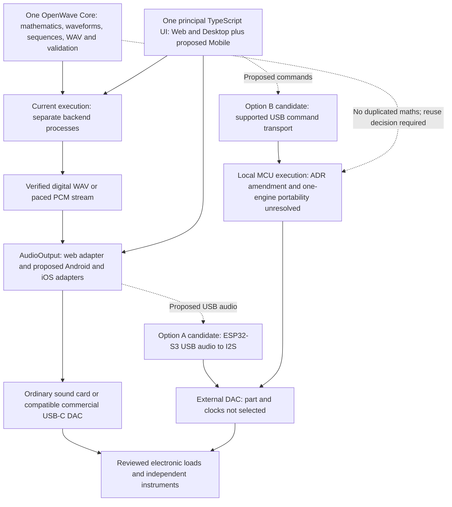

# OpenWave Portable concept

22 October 2026. Proposed direction, INV-04/05/07. This extends the vision without replacing the accepted file-only milestone or authorizing mobile/hardware implementation.

The intended experience is a smartphone with locally stored waveform files, USB-C audio and a compact external interface where necessary. Users should eventually edit custom sequences, generate/load files and control playback without a laptop, USB stick or desktop generator. Targets are Android phones with verified USB host/audio support and USB-C iPhones. Affordability, portability, battery life and usability are goals awaiting requirements and measurement; no funded delivery commitment or price is established.

The maintainer's architectural direction is one shared OpenWave engine, one principal TypeScript UI and separate audio adapters for web, Android and iOS. This avoids duplicating sequence logic and waveform generation. Framework choice follows the audit and playback-capability validation; native development is not yet authorized. “Shared engine” retains backend worker execution under ADR-001 rather than putting synthesis into every client.

The later authorized [desktop player](Desktop-Player.md) now implements the browser adapter and shared `AudioOutput` contract. It adds square/triangle and paced live backend streams to the engine without implementing this Portable product, a native mobile UI or human-contact hardware. Reuse that code/contract when evaluating future mobile adapters; do not build a parallel engine or UI.

## Reference workflow

The owner reports audio files on a USB stick being played and processed by the Electro-Med 235p before electrical delivery through metal hand electrodes, with possible footplate accessories. This is an owner account, not an electrical specification. Gain, filtering and other conditioning remain unmeasured. Replacing the playback source does not establish replacement of the machine's output stages. See [INV-01/03](Existing-Machine-Investigation.md).

| Increment | Scope |
| --- | --- |
| Existing file milestone | Web editor requests backend-worker sine PCM16 WAV export; digital verification, no live output |
| Mobile POC 1 | Load/import a verified WAV or request backend sine generation; retain locally and start/stop native playback through a verified USB-C route into an electronic load |
| Desktop waveform expansion | v0.4 defines and digitally tests square/triangle in the existing backend engine; mobile POC 1 remains sine-first until its scope/acceptance is extended |
| Later offline/live generation | Requires an explicit ADR-001 decision; caching or Capacitor does not provide this |
| Future electrical-output product | Separate measured requirements, isolation/fault review and approval; no direct DAC-to-electrode implementation |

POC 1 is file-based and selects sine explicitly. Offline playback of pre-generated sequences preserves backend-only synthesis; new custom generation still needs backend connectivity. The loopback API is not a phone/cloud deployment and must not simply be exposed on a LAN to support this concept.

See [mobile capabilities](Mobile-Capabilities.md), [ADR-002](../ADR-002-Mobile-Playback.md), [question register](Mobile-Question-Register.md) and [POC acceptance](Mobile-POC.md). Funding, procurement, body-contact validation and medical efficacy remain outside this proposal.

## Proposed Portable hardware composition

The long-term vision remains a compact smartphone-controlled USB-C system that generates/plays selected waveform programmes without the bulky Electro-Med. This is a product objective, not a delivered standalone generator or validated human-contact device. A future electrode interface remains an open hardware/safety workstream. No custom manufacturing requirement is adopted unless commercial alternatives are shown unable to meet measured specifications.

Keep **waveform generation → audio playback → external hardware interface** independent. OpenWave Core owns mathematics, waveform definitions, sequencing, WAV encoding and validation; it is currently implemented in backend domain modules, not an extracted cross-platform firmware package. Web/Desktop owns the existing player, frequency/digital-amplitude controls, sequence management and supported device selection. Mobile proposes Android/iPhone adapters, retained offline WAV playback and USB-C output. Portable hardware investigates an ESP32-S3 candidate, UAC or a separately reviewed command interface, external DAC and diagnostics. Optional future validated output hardware is outside the bench paths below.

Dashed paths are research proposals, not implemented or authorized execution paths. The diagram does not add firmware, a local synthesis fallback or a body-contact connection. See the [ESP32-S3 comparison](ESP32-S3-Investigation.md) for sources, UAC/command trade-offs, iPhone restrictions and DAC requirements.

## Portable hardware decision register

22 October 2026. New register of the existing direction and this review's candidate choices; it is not a new accepted ADR or a change to `main`. Previous hardware choices were unselected; no adoption occurs here.

| Decision | Disposition and evidence | Remaining decision / next action |
| --- | --- | --- |
| P-D01: Independent generation, playback and hardware boundaries | Maintainer-confirmed direction, ADR-002/003; desktop implementation exists | Keep engine/UI shared and future hardware adapters independent |
| P-D02: ESP32-S3 with external DAC as candidate | FEASIBLE — NOT YET VERIFIED; S47–S51, M-Q23/24 | No board selected; baseline commercial DAC first |
| P-D03: USB audio versus USB commands | DECISION REQUIRED; Option A reuses retained WAVs, Option B has additional iPhone transport/engine risk | Gather phone/UAC and command-access evidence before choosing |
| P-D04: Local embedded generation | DECISION REQUIRED; M-Q26, current ADR-001 forbids moving synthesis silently | Reviewed execution amendment, portability plan and conformance tests before firmware |
| P-D05: Amplifier/conditioning requirement | OPEN — INVESTIGATION REQUIRED for analog load needs; conceptual frequency question answered in M-Q22 | Compare measured voltage/current/response with agreed load requirements |
| P-D06: Custom hardware manufacture | Deferred, no demonstrated requirement | Prefer commercially available alternatives; justify a gap, rights, funding and specialist review before custom work |

The single next hardware evidence milestone is [OpenWave Analog Output Characterisation](Hardware-and-Electrical-Safety.md#openwave-analog-output-characterisation), not immediate ESP32 firmware development.
