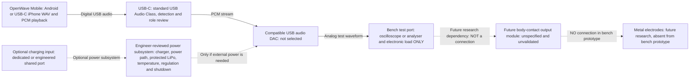
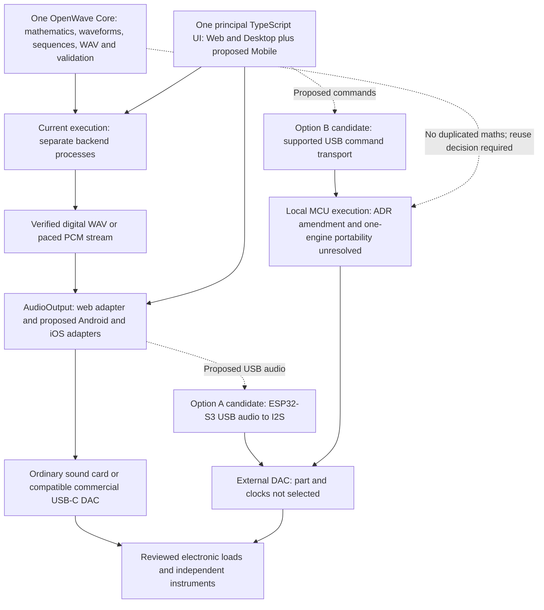

# OpenWave Portable concept

22 October 2026. Proposed direction, INV-04/05/07. This extends the vision without replacing the accepted file-only milestone or authorizing mobile/hardware implementation.

The intended experience is a smartphone with locally stored waveform files, USB-C audio and a compact external interface where necessary. Users should eventually edit custom sequences, generate/load files and control playback without a laptop, USB stick or desktop generator. Targets are Android phones with verified USB host/audio support and USB-C iPhones. Affordability, portability, battery life and usability are goals awaiting requirements and measurement; no funded delivery commitment or price is established.

The maintainer's architectural direction is one shared OpenWave engine, one principal TypeScript UI and separate audio adapters for web, Android and iOS. This avoids duplicating sequence logic and waveform generation. Framework choice follows the audit and playback-capability validation; native development is not yet authorized. “Shared engine” retains backend worker execution under ADR-001 rather than putting synthesis into every client.

The later authorized [desktop player](Desktop-Player.md) now implements the browser adapter and shared `AudioOutput` contract. It adds square/triangle and paced live backend streams to the engine without implementing this Portable product, a native mobile UI or human-contact hardware. Reuse that code/contract when evaluating future mobile adapters; do not build a parallel engine or UI.

## Reference workflow

The owner reports audio files on a USB stick being played and processed by the Electro-Med 235p before electrical delivery through metal hand electrodes, with possible footplate accessories. This is an owner account, not an electrical specification. Gain, filtering and other conditioning remain unmeasured. Replacing the playback source does not establish replacement of the machine's output stages. See [INV-01/03](Existing-Machine-Investigation.md).

| Increment | Scope |
| --- | --- |
| Existing file milestone | Web editor requests backend-worker sine PCM16 WAV export; digital verification, no live output |
| Mobile POC 1 | Load/import a verified WAV or request backend sine generation; retain locally and start/stop native playback through a verified USB-C route into an electronic load |
| Desktop waveform expansion | v0.4 defines and digitally tests square/triangle in the existing backend engine; mobile POC 1 remains sine-first until its scope/acceptance is extended |
| Later offline/live generation | Requires an explicit ADR-001 decision; caching or Capacitor does not provide this |
| Future electrical-output product | Separate measured requirements, isolation/fault review and approval; no direct DAC-to-electrode implementation |

POC 1 is file-based and selects sine explicitly. Offline playback of pre-generated sequences preserves backend-only synthesis; new custom generation still needs backend connectivity. The loopback API is not a phone/cloud deployment and must not simply be exposed on a LAN to support this concept.

See [mobile capabilities](Mobile-Capabilities.md), [ADR-002](../ADR-002-Mobile-Playback.md), [question register](Mobile-Question-Register.md) and [POC acceptance](Mobile-POC.md). Funding, procurement, body-contact validation and medical efficacy remain outside this proposal.

## Concept v0.2 functional specification

23 October 2026. **Under review**, based on the maintainer-supplied functional block diagram and requirements [S56]. This is not a circuit schematic, PCB/fabrication package, selected bill of materials or approved safety design. No new hardware test result accompanies it.

The proposed baseline is **phone → standard USB Audio Class DAC → instrumented electronic test load**. No ESP32 or AD9833 is in the baseline. A controller is reconsidered only for demonstrated diagnostics, proprietary device controls, monitoring or independent playback needs. The optional power subsystem does not mean a battery is required.

| Block | Required function | Decision / verification |
| --- | --- | --- |
| Phone application | Generate/request and play WAV / PCM frequency sequences | Verify Android and USB-C iPhone. Preserve the shared engine and backend execution: request generation, retain files and play locally; on-phone synthesis is not authorized |
| USB-C link | Standard USB Audio Class streaming and detection | Verify selected DAC/cable enumeration, route, unplug/replug and supported/negotiated sample rates |
| DAC | Reproduce intended analog waveform | Measure frequency, voltage, distortion and sample-rate behaviour into suitable non-human loads; no DAC selected or calibrated |
| Battery / charger | Optional if phone-powered; otherwise investigate protected rechargeable LiPo | Define load budget, power path, regulation/shutdown, temperature supervision, protection and safe charging arrangement before selection |
| Controller / ESP32 | Not part of baseline | Reconsider only for diagnostics, proprietary controls, monitoring or independent playback; no firmware approval |
| Output module | Unspecified future research block | Qualified Electro-Med 235p characterization; define ratings, regulation, isolation, fault detection and protections separately |
| Electrodes | Future research only | No connection to ordinary USB audio electronics or unvalidated amplifiers; independent safety engineering required |

The optional power block is a functional grouping, not a selected charging topology or wiring diagram. Phone-supplied USB power is the first investigation. “Line-level test signal” in the supplied image describes an intended bench role; the selected DAC's actual output type, level and rating remain unspecified. The dashed output path is a future research dependency, not a safe or approved connection. Do not connect a standard DAC or unvalidated amplifier directly to body-contact electrodes.

The drawing's mobile “generator + player” describes the intended workflow. It does not change ADR-001's backend synthesis rule or authorize a duplicate engine, on-phone synthesis or offline custom generation. One shared engine, the principal TypeScript UI and platform playback adapters remain the software direction.

### Critical open engineering questions

| Question | Investigation mapping | Required evidence / next action |
| --- | --- | --- |
| 1. Reliable class-compliant DAC on Android and USB-C iPhone, including lock/interruption behaviour? | INV-04/05; M-Q05/08/17 | Named phone/OS/DAC/firmware/cable matrix, enumeration, negotiated formats, route confirmation, continuity and interruption/unplug/replug captures |
| 2. Is a battery needed, or can the phone power the baseline DAC? | INV-05; M-Q18 | Actual startup/steady load budget, phone supply behaviour, runtime and thermal measurements; do not add a cell by assumption |
| 3. If battery-powered, dedicated USB-C charging port or shared audio/charging port? | INV-05/06; M-Q28 | Engineer-reviewed power/data roles, power path, backfeed/fault, charging and thermal behaviour; neither arrangement selected |
| 4. What does Electro-Med 235p produce into instrumented electronic loads? | INV-01/03/06; M-Q11/27 | Qualified isolation/safety review before its output measurements, then load-defined waveform, voltage/current, timing and transfer records |
| 5. Protection, fault detection, isolation and regulation for a future body-contact module? | INV-05/06; M-Q13 | Separate intended-use requirements and independent safety engineering; not resolved by DAC playback or a protected cell |
| 6. Can the complete validated product meet 80 x 50 x 20 mm and under 100 g? | INV-05; M-Q29 | Full components/enclosure/connectors/power/protection budget, thermal review and measured assembled dimensions/mass |

**80 x 50 x 20 mm and under 100 g are aspirational targets**, not accepted limits or measured results. None of these questions is closed by the drawing. See the [power/output review](Hardware-and-Electrical-Safety.md#concept-v02-power-and-output-review) and [question follow-up](Mobile-Question-Register.md#concept-v02-follow-up--23-october-2026).

## Earlier Portable alternatives — 22 October 2026

Historical candidate comparison retained for traceability. The ESP32 paths in the following diagram are outside the concept v0.2 baseline above; they are not dependencies for the first DAC prototype.

The long-term vision remains a compact smartphone-controlled USB-C system that generates/plays selected waveform programmes without the bulky Electro-Med. This is a product objective, not a delivered standalone generator or validated human-contact device. A future electrode interface remains an open hardware/safety workstream. No custom manufacturing requirement is adopted unless commercial alternatives are shown unable to meet measured specifications.

Keep **waveform generation → audio playback → external hardware interface** independent. OpenWave Core owns mathematics, waveform definitions, sequencing, WAV encoding and validation; it is currently implemented in backend domain modules, not an extracted cross-platform firmware package. Web/Desktop owns the existing player, frequency/digital-amplitude controls, sequence management and supported device selection. Mobile proposes Android/iPhone adapters, retained offline WAV playback and USB-C output. Portable hardware investigates an ESP32-S3 candidate, UAC or a separately reviewed command interface, external DAC and diagnostics. Optional future validated output hardware is outside the bench paths below.

Dashed paths are research proposals, not implemented or authorized execution paths. The diagram does not add firmware, a local synthesis fallback or a body-contact connection. See the [ESP32-S3 comparison](ESP32-S3-Investigation.md) for sources, UAC/command trade-offs, iPhone restrictions and DAC requirements.

## Portable hardware decision register

Created 22 October; updated 23 October 2026 for concept v0.2 [S56]. Proposed scope is distinct from accepted hardware design. No component, power topology or body-contact connection is selected; this is not a change to `main`.

| Decision | Disposition and evidence | Remaining decision / next action |
| --- | --- | --- |
| P-D01: Independent generation, playback and hardware boundaries | Maintainer-confirmed direction, ADR-002/003; desktop implementation exists | Keep engine/UI shared and future hardware adapters independent |
| P-D02: ESP32-S3 with external DAC as candidate | Deferred alternative; excluded from concept v0.2 baseline [S56]; earlier feasibility finding unchanged | Reconsider only for demonstrated diagnostics, proprietary controls, monitoring or independent playback needs |
| P-D03: USB audio versus USB commands | Proposed v0.2 baseline uses standard USB Audio Class; custom commands outside baseline [S56] | Verify exact mobile/DAC pairs; retain controller command research only for a later justified scope |
| P-D04: Local embedded generation | DECISION REQUIRED; M-Q26, current ADR-001 forbids moving synthesis silently | Reviewed execution amendment, portability plan and conformance tests before firmware |
| P-D05: Amplifier/conditioning requirement | OPEN — INVESTIGATION REQUIRED for analog load needs; conceptual frequency question answered in M-Q22 | Compare measured voltage/current/response with agreed load requirements |
| P-D06: Custom hardware manufacture | Deferred, no demonstrated requirement | Prefer commercially available alternatives; justify a gap, rights, funding and specialist review before custom work |
| P-D07: Phone power, battery and charging ports | DECISION REQUIRED; battery optional, topology unspecified [S56] | Measure DAC load and phone supply before choosing a battery or dedicated/shared charging port |
| P-D08: Portable form factor | Aspirational 80 x 50 x 20 mm and under 100 g [S56]; no verified fit/mass | Validate the complete enclosure/component/power/protection composition before accepting limits |

The single next hardware evidence milestone is [OpenWave Analog Output Characterisation](Hardware-and-Electrical-Safety.md#openwave-analog-output-characterisation), not immediate ESP32 firmware development.
